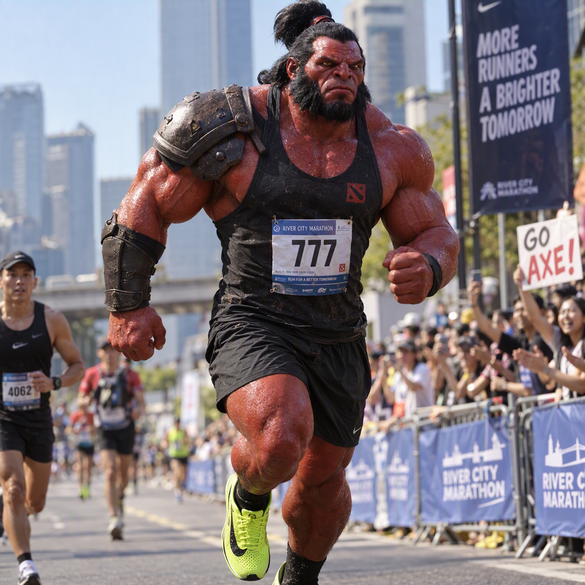

# A Grande Corrida dos Ancestrais: Quando os Heróis de Dota 2 Tentaram Correr 42 km 🏃‍♂️⚔️

## 🚀 Introdução
Uma exploração cômica e criativa de como seria se os heróis de Dota 2 trocassem seus itens mágicos por tênis de placa de carbono e encarassem uma maratona de 42 km de asfalto.

## 🎯 Objetivo
Criar um crossover com alto nível de detalhe unindo universo esportivo (corrida de rua) e o universo gamer de Dota 2, explorando ferramentas de IA generativa para texto e imagem.

## 🛠️ Tecnologias Utilizadas
- **IA Generativa de Imagem:** [Nome da ferramenta que você usou, ex: Bing Image Creator / Midjourney]
- **IA Generativa de Texto:** [Nome da ferramenta que você usou, ex: ChatGPT / Gemini]

## 💭 Processo de Criação
1. Definição do conceito: unir dois hobbies reais (Dota 2 e corrida).
2. Criação do prompt de imagem focado em fotografia esportiva realista com elementos do Dota.
3. Elaboração do prompt de texto exigindo termos técnicos reais de fisiologia de corrida misturados às mecânicas clássicas de habilidades do jogo.

## 🏆 Resultados

### Crônica da Prova:
> O clima no Bosque dos Ancestrais parecia ideal para bater recorde pessoal: 16°C, asfalto seco e nenhuma criatura neutra bloqueando o trajeto. No entanto, trocar as botas de teletransporte por supertênis com placa de carbono provou ser o maior teste de sanidade física que a defesa dos Anciões já testemunhou.
>
> A largada da primeira maratona de Dota foi caótica. Enquanto os heróis de suporte tentavam posicionar sentinelas nos postos de hidratação para evitar gargalos, os carregadores ignoraram completamente as cartilhas de periodização esportiva. O resultado? Uma carnificina metabólica de ácido lático, bolhas nos pés e puro colapso biomecânico logo após a meia maratona.
>
> ### Os Depoimentos do Pelotão
> **Axe sobre ritmo de prova e frequência cardíaca:**  
> "Axe não precisa de zona 2! Treinador disse para Axe correr em ritmo conversacional a 5:30 min/km. Axe respondeu com Culling Blade no relógio! Axe cravou 2:45 min/km desde o pórtico. Frequencímetro cardíaco travou em 205 bpm no quilômetro 12? Ótimo, significa que o coração está girando como um Counter Helix! Se a perna doer, é só gritar 'Axe brought an axe!' e atropelar o coelho da prova. Pace defensivo é coisa de quem não builda armadura."
>
> **Bloodseeker e a polêmica da largada kamikaze:**  
> "Minha estratégia era puramente fisiológica: Thirst ativada no quilômetro zero. Vi três atletas da elite tropeçarem na largada e perderem um pouco de sangue nos joelhos; naquele momento meu corpo ignorou o limiar de lactato. Abri os primeiros 10 km num sprint descontrolado achando que estava com bônus de velocidade ilimitado. No quilômetro 28, a glicemia zerou, a carcaça pesou e a Ruptura foi nos meus próprios isquiotibiais: se eu desse mais um passo a 3:10 min/km, minha panturrilha explodia. Faltou carbo gel de ação lenta, admito."
>
> **Crystal Maiden e o colapso térmico:**  
> "Uma vergonha de organização. Disseram que teríamos isotônico gelado a cada 2,5 km, mas o que encontrei foi água morna e sol direto na cabeça. Meu consumo de VO2 máx simplesmente derreteu! Tentei improvisar uma Freezing Field na altura do km 30 para abaixar a sensação térmica e recuperar o drop do meu calçado, mas os fiscais de prova me desclassificaram por uso indevido de magia de área no asfalto. Sem Tango para repor eletrólitos e sem a minha Aura de Mana para segurar a desidratação, abandonei a prova antes do 'muro' dos 32 km."
>
> *Dos 124 heróis alinhados na largada, apenas Weaver cruzou a linha de chegada abaixo das 2h05 — embora haja suspeitas graves de uso irregular de Time Lapse para voltar no tempo toda vez que sentia canelite.*

## 🧐 Natty or Not? (Reflexão)
- **Fake Natty com louvor:** A combinação é completamente surreal e fantástica, mas a verossimilhança dos termos técnicos de fisiologia humana e a qualidade fotográfica da imagem gerada criam uma ilusão convincente e bem-humorada.
